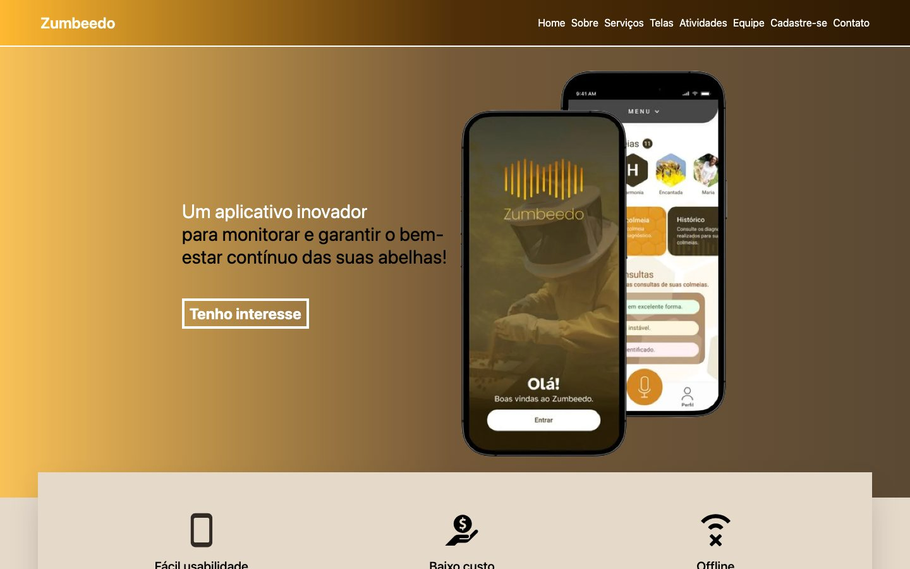
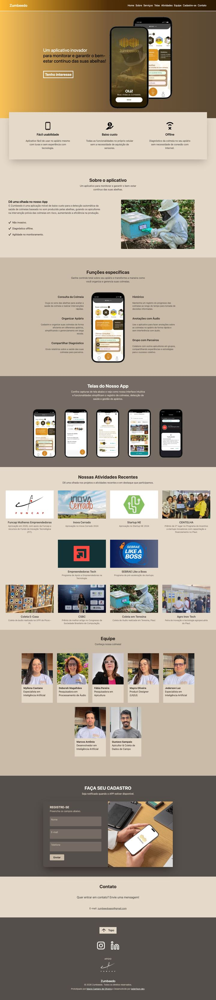
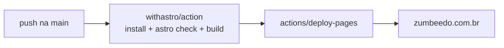
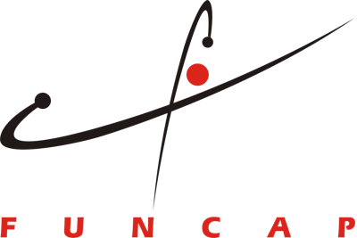

<div align="center">


# Zumbeedo

**Um aplicativo para monitorar e garantir o bem-estar contínuo das suas abelhas.**

Landing page oficial do Zumbeedo.

[](https://github.com/zumbeedo/zumbeedo-lp/actions/workflows/deploy.yml)
[](https://zumbeedo.com.br)


[**Ver o site**](https://zumbeedo.com.br) ·
[Instagram](https://www.instagram.com/zumbeedoapp/) ·
[LinkedIn](https://www.linkedin.com/company/zumbeedo/) ·
[Contato](mailto:zumbeedoapp@gmail.com)

<br />



</div>

---

## Sumário

- [Sobre o Zumbeedo](#sobre-o-zumbeedo)
- [O que tem no site](#o-que-tem-no-site)
- [Stack](#stack)
- [Começando](#começando)
- [Estrutura do projeto](#estrutura-do-projeto)
- [Guia de conteúdo](#guia-de-conteúdo)
- [Formulário de cadastro](#formulário-de-cadastro)
- [Qualidade: desempenho, acessibilidade e SEO](#qualidade-desempenho-acessibilidade-e-seo)
- [Meta Pixel](#meta-pixel)
- [Deploy](#deploy)
- [Contribuindo](#contribuindo)
- [Equipe](#equipe)
- [Apoio](#apoio)
- [Licença](#licença)

## Sobre o Zumbeedo

O Zumbeedo é uma aplicação móvel de baixo custo que detecta automaticamente a saúde de colmeias a partir do som produzido pelas abelhas. Com isso, apicultores conseguem intervir antes nas colmeias em risco e aumentar a eficiência da produção.

| | |
| :-- | :-- |
| 🧤 **Fácil de usar** | Funciona no apiário mesmo com luvas e sem experiência com tecnologia. |
| 💰 **Baixo custo** | Tudo no próprio celular, sem comprar sensores. |
| 📴 **Offline** | Diagnóstico da colmeia sem conexão com a internet. |

Este repositório contém **apenas a landing page**. O aplicativo e a API ficam em outros repositórios.

## O que tem no site

É uma página única, com as seções nesta ordem (cada uma tem um `id` usado pelo menu):

| Seção | `id` | Conteúdo |
| :-- | :-- | :-- |
| Home | `#home` | Chamada principal e botão "Tenho interesse" |
| Sobre | `#about` | O que é o app e seus diferenciais |
| Serviços | `#services` | Funções do app (consulta da colmeia, histórico, anotações com áudio…) |
| Telas | `#screens` | Capturas de tela do aplicativo |
| Atividades | `#activities` | Prêmios, editais e coletas de campo |
| Equipe | `#squad` | Quem faz o Zumbeedo |
| Cadastre-se | `#registry` | Formulário de acesso antecipado |
| Contato | `#contact` | E-mail e redes sociais |

<details>
<summary><b>Ver a página inteira</b></summary>
<br />

</details>

## Stack

| Camada | Tecnologia |
| :-- | :-- |
| Framework | [Astro 7](https://astro.build), gerando site estático |
| Estilos | [Tailwind CSS 4](https://tailwindcss.com) via `@tailwindcss/vite`, com o tema em `src/styles/global.css` |
| Imagens | `astro:assets`, que converte para WebP e gera `srcset` no build |
| Tipos | TypeScript, checado com `astro check` a cada build |
| Hospedagem | GitHub Pages, publicado por GitHub Actions |
| Métricas | Meta Pixel, pronto em `MetaPixel.astro`, mas [desligado](#meta-pixel) |

Não há framework de UI no cliente. Os poucos scripts da página (menu do celular, máscara de telefone e envio do formulário) são TypeScript puro dentro dos próprios componentes `.astro`.

## Começando

### Pré-requisitos

- **Node 22**. A versão está fixada em [`.nvmrc`](.nvmrc); com o [nvm](https://github.com/nvm-sh/nvm), basta rodar `nvm use`.
- npm (vem com o Node).

### Instalação

```bash
git clone https://github.com/zumbeedo/zumbeedo-lp.git
cd zumbeedo-lp
nvm use
npm install
npm run dev
```

O site abre em **http://localhost:4321** e recarrega sozinho a cada alteração.

### Scripts

| Comando | O que faz |
| :-- | :-- |
| `npm run dev` | Sobe o servidor de desenvolvimento |
| `npm run build` | Roda `astro check` (tipos) e gera o site estático em `dist/` |
| `npm run preview` | Serve o `dist/` para conferir o resultado final antes do deploy |
| `npm run astro -- <cmd>` | Acesso direto à CLI do Astro |

> [!TIP]
> Se uma imagem trocada continuar aparecendo com a versão antiga no `npm run dev`, é cache do navegador. Recarregue com <kbd>Cmd</kbd>+<kbd>Shift</kbd>+<kbd>R</kbd>. Em produção isso não acontece, porque o build dá a cada versão da imagem um nome de arquivo novo.

## Estrutura do projeto

```text
zumbeedo-lp/
├── .github/workflows/
│   └── deploy.yml           # build + deploy no GitHub Pages a cada push na main
├── docs/                    # imagens usadas neste README
├── public/                  # servido como está, sem processamento
│   ├── CNAME                # domínio zumbeedo.com.br
│   ├── favicon.svg
│   ├── robots.txt
│   └── sitemap.xml
├── src/
│   ├── assets/
│   │   ├── images/
│   │   │   ├── activities/      # cards de "Nossas Atividades Recentes"
│   │   │   └── collaborators/   # fotos da equipe
│   │   └── svgs/                # ícones usados pelo componente <Icon>
│   ├── components/          # Activities, Collaborator, Pros, FuncDescription, TextInput, Icon, MetaPixel…
│   ├── layouts/
│   │   └── Layout.astro     # <head>: metatags e Open Graph
│   ├── pages/
│   │   └── index.astro      # a página inteira: menu, seções e formulário
│   └── styles/
│       └── global.css       # cores do tema e estilos base
├── astro.config.mjs
└── package.json
```

## Guia de conteúdo

Quase toda edição de conteúdo acontece em [`src/pages/index.astro`](src/pages/index.astro).

### Adicionar uma atividade

1. Coloque a imagem em `src/assets/images/activities/` (`.png`, `.jpg` ou `.jpeg`). O card mostra a imagem na proporção **12:7** (por exemplo 1200×700) e recorta o que sobrar.
2. Adicione um item na lista `<Activities items={[...]}>`. O primeiro item da lista aparece primeiro.

```js
{
  imgSrc: "/src/assets/images/activities/nome-do-arquivo.png",
  title: "Nome curto",
  description: "Uma ou duas linhas sobre a conquista.",
},
```

### Adicionar ou atualizar alguém da equipe

1. Coloque a foto em `src/assets/images/collaborators/`. Ela deve ser **quadrada** (600×600 basta), com enquadramento de cabeça e ombros.
2. Edite a lista `<Collaborator items={[...]}>` com `imgSrc`, `name` e `role`.

### Mudar o menu

O menu do desktop e o do celular usam a mesma lista, `navLinks`, no topo de `index.astro`. Cada `link` aponta para o `id` de uma seção. Mantenha a ordem do menu igual à ordem das seções na página.

### Cores

As cores do tema (`brand`, `primary`, `secondary`) ficam no bloco `@theme` de [`src/styles/global.css`](src/styles/global.css) e viram classes do Tailwind, como `bg-brand-700` e `text-secondary-200`.

## Formulário de cadastro

O formulário da seção **Cadastre-se** envia um `POST` com JSON para a API do Zumbeedo:

```http
POST https://zumbeedo-ai-api-homologacao.up.railway.app/early-access/
Content-Type: application/json

{ "name": "…", "email": "…", "phone": "(86) 9 9999-9999" }
```

- Os três campos são obrigatórios e têm `autocomplete`, para o celular preencher sozinho.
- O telefone recebe máscara enquanto a pessoa digita.
- Qualquer resposta fora da faixa 2xx é tratada como erro.
- O botão fica desabilitado durante o envio, e a mensagem de resultado continua na tela até o próximo envio.

## Qualidade: desempenho, acessibilidade e SEO

**Desempenho**

- Todas as imagens passam pelo `astro:assets` e saem em WebP.
- Os cards de atividades e da equipe têm `srcset`/`sizes`, então o navegador baixa só o tamanho que vai mostrar (1x ou 2x).
- O site é HTML estático, sem framework JavaScript no cliente.

**Acessibilidade**

- O menu do celular usa um botão com `aria-expanded`.
- Os ícones de redes sociais têm `aria-label`, e o resultado do formulário é anunciado com `role="status"`.
- A rolagem suave e a animação do menu são desligadas para quem ativou "reduzir movimento" no sistema (`prefers-reduced-motion`).

**SEO**

- `lang="pt-BR"`, URL canônica, `description`, Open Graph e Twitter Card com imagem em URL absoluta.
- `robots.txt` e `sitemap.xml` em `public/`.

## Meta Pixel

O pixel da Meta (ID `1563030861063294`) está **desligado** porque não há anúncios rodando. Ele coleta dados de navegação para anúncios, e pela LGPD isso só pode acontecer depois do consentimento de quem visita o site.

O código continua pronto em [`src/components/MetaPixel.astro`](src/components/MetaPixel.astro). Para reativar quando forem anunciar:

1. Crie um banner de consentimento com **Aceitar** e **Recusar** e salve a escolha no navegador (`localStorage`).
2. Renderize `<MetaPixel />` no `<head>` de [`Layout.astro`](src/layouts/Layout.astro), mas só depois do **Aceitar**. Ou seja, os scripts dele precisam ser injetados pelo banner, e não carregados direto na página.
3. Atualize a política de privacidade, se houver, citando a Meta.

> [!WARNING]
> Não basta só voltar com o `<MetaPixel />` no layout. Sem o banner, o pixel volta a rastrear todo mundo sem consentimento.

## Deploy

Todo push na `main` dispara o workflow [`deploy.yml`](.github/workflows/deploy.yml):



- O domínio vem de [`public/CNAME`](public/CNAME).
- O workflow também pode ser rodado manualmente pela aba **Actions** (`workflow_dispatch`).
- Se o `astro check` encontrar erro de tipo, o build falha e nada é publicado.

## Contribuindo

1. Crie uma branch a partir da `main`: `git checkout -b feat/minha-mudanca`.
2. Rode `npm run build` antes de abrir o PR. Ele precisa passar sem erros.
3. Use mensagens de commit no padrão [Conventional Commits](https://www.conventionalcommits.org/pt-br/), como no histórico do projeto: `feat:`, `fix:`, `perf:`, `chore:`.
4. Abra um Pull Request descrevendo a mudança. Se ela for visual, inclua um print.

## Equipe

| | Nome | Papel |
| :-: | :-- | :-- |
|  | Myllena Caetano | Especialista em Inteligência Artificial |
|  | Deborah Magalhães | Pesquisadora em Processamento de Áudio |
|  | Fábia Pereira | Pesquisadora em Apicultura |
|  | Mayra Oliveira | Product Designer (UX/UI) |
|  | Jederson Luz | Especialista em Inteligência Artificial |
|  | Marcos Antônio | Desenvolvedor em Inteligência Artificial |
|  | Gustavo Sampaio | Apicultor & Coleta de Dados de Campo |

## Apoio

<a href="https://www.funcap.ce.gov.br"></a>

Projeto aprovado no Edital Funcap de Inovação Empresarial nº 04/2026 (Programa Funcap Mulheres Empreendedoras), com apoio financeiro da Funcap e recursos do Fundo de Inovação Tecnológica (FIT).

## Licença

© Zumbeedo. Todos os direitos reservados. O código e o conteúdo deste repositório não podem ser reutilizados sem autorização.

---

<div align="center">
<sub>Feito com 🐝 pela equipe Zumbeedo · <a href="mailto:zumbeedoapp@gmail.com">zumbeedoapp@gmail.com</a></sub>
</div>
